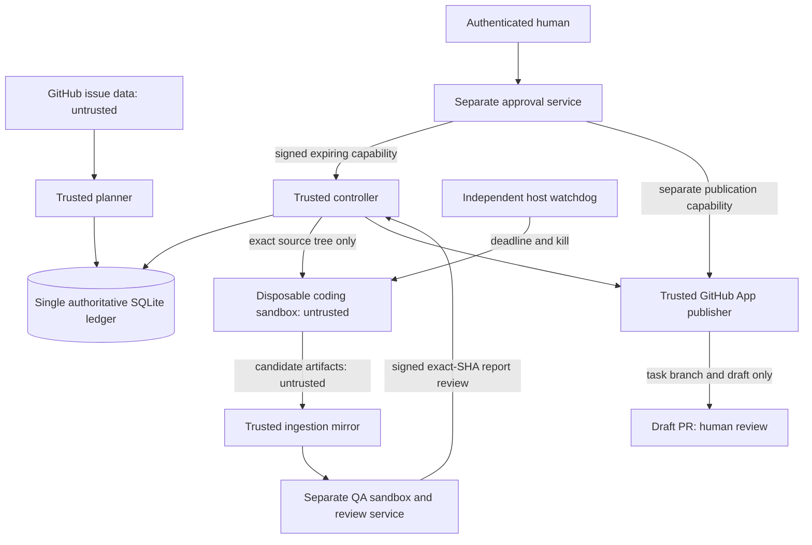

# Sprint 5.3 — trusted control plane and blocked live canary

**Live execution and client/server publication remain blocked in code.** This PR
provides tested control-plane infrastructure and an offline rehearsal. It does not
establish a hard billing ceiling, attest a deployed sandbox, deploy an authenticated
approval service, or certify a live system as production-ready. No setting, approval
envelope, environment variable or worker edit can turn on live execution in this
release. `trust.require_live()` rejects every live entrypoint. Do not remove it just
to run a canary. Read the activation blockers below first.

## Architecture and trust boundaries



The controller, issuer, independent reviewer, immutable policy installation,
trusted Git mirror and ledger are trusted computing base. The worker can read
repository content and mutate only its disposable export; it cannot reach any
controller/QA keys, ledger, socket, approval setting or GitHub credentials. QA has
a separate image, OS identity and service from coding. QA never imports repository
modules into the controller. Candidate tests execute only in the QA sandbox.

The original Sprint 5.2 controller and mock adapters remain available for their
existing synthetic tests. They are **not** live authorization interfaces. A 5.3
ledger fences legacy dispatch and advisory planning, so simulated `human:*` strings
cannot authorize a task in the new authority.

## Implemented components

| Component | Contract |
|---|---|
| `trust.py` | HMAC-SHA256 issuer assertion, configured human subjects, issuer/audience/action/scope, at most 15 minutes, unique nonce consumed atomically |
| `secure_ledger.py` | Additive schema, immutable grant/event/usage/report records, $3 reservation, $10 daily accounting, one live/mock worker slot, two retries, leases, restart fencing, persistent stop |
| `codex_adapter.py` | Official CLI JSONL interface, exact-tree export, pinned-image gVisor container specification, sanitized process environment, resource limits, timeout/cancellation, process group and named-container cleanup |
| `metering.py` | Strict provider token-event parser, requested model identity and provider execution ID, optional versioned price estimate, no token-to-invoice claim |
| `independent_qa.py` | Full binary diff, exact SHAs, file/mode checks, fresh export, sandbox tests, controller-origin report, distinct authenticated risk review |
| `publication.py` | Dedicated App HTTP/Git transport and transactional publication outbox; verify destination/head, create task branch only, draft only, deduplicate/recover ambiguous responses |
| `rehearsal.py` | Synthetic issue, approval issuer, collector and billing, mock worker in a disposable Git checkout, actual fixture test execution, independent review and mock GitHub sequence |

No real Codex command or Docker container is invoked by the tests/rehearsal. The
harmless local subprocess tests exercise timeout, cancellation and environment
scrubbing. The fixture test runner is for the generated trusted fixture only;
it is deliberately not presented as isolation for hostile code. Operational
ledgers reject synthetic accounting and synthetic QA.

## Threat model

| Threat | Enforced boundary / residual requirement |
|---|---|
| Prompt injection in issues, repository, agent output | Values stay data; no shell interpolation. Immutable controller-side repository/branch/file scope; sandbox cannot authorize anything. |
| Worker edits policy, workflow or approval rules | Protected paths block QA; policies/services run outside worker mounts. Existing repository instructions never establish authorization. |
| Forged/replayed/modified human approval | Signature, trusted subject, issuer/audience/action and exact scope; time bounds; nonce unique in the action transaction. Missing identity fails closed. |
| Worker forges QA or token/cost evidence | QA recomputes diff/tests and stores report itself; a separate verifier accepts risk review. Collector provenance must be external; CLI output alone is not billing. |
| Multiple schedulers/workers/retries | SQLite `BEGIN IMMEDIATE`, durable task identity/branch ownership, one active run, persistent unresolved holds, at most three attempts. |
| Controller/worker crash, runaway descendant | Lease fencing and retained reservation; process group kill plus container removal/inventory check; external host watchdog required for controller death. |
| Network/credential exfiltration | `--network=none`, no keys/proxies/controller mounts/Docker socket, nonroot user, gVisor, caps dropped, readonly root, bounded writable mounts. Deployment attestation still required. |
| Stale QA/branch, lost GitHub responses | Exact candidate/report binding, absent-branch-only push, remote head verification, durable outbox, inspect all PR states before retry. No blind retry/create. |
| Ledger loss/tampering | Missing/corrupt state fails closed; immutable SQL audit tables protect against accidental mutation. OS ACLs, authenticated backups and external audit retention are required against privileged administrator tampering. |

HMAC assumes the controller is trusted: a verifier holding its key can also sign.
Worker and QA test containers hold no verification/signing keys. Deploy issuer and
controller under separate service identities; the independent review signer uses
a different key/audience/human allowlist. A future asymmetric/KMS implementation
can replace `Verifier` without changing the action binding/nonce transaction.

## Official Codex interface and cost investigation

The adapter uses `codex exec --json`, stdin prompt `-`, `--ephemeral`,
`--ignore-user-config`, `--ignore-rules`, `--model`, `--sandbox workspace-write`,
`--skip-git-repo-check`, and `sandbox_workspace_write.network_access=false`.
The exact source tree is exported from a verified SHA with no `.git`, shared
objects, remotes, hooks or controller config. It is a disposable checkout of that
tree; the immutable source SHA stays in the signed grant and ledger. Candidate
artifacts must subsequently enter a trusted mirror through an audited ingestion
service; a worker's `.git/config` is never used for controller Git operations.

Inspected upstream source on 2026-10-22, commit
`86e17e98c7f901277aeeb4649cf1b01462b082f2`:

- [CLI exec arguments](https://github.com/openai/codex/blob/86e17e98c7f901277aeeb4649cf1b01462b082f2/codex-rs/exec/src/cli.rs)
- [SDK event types](https://github.com/openai/codex/blob/86e17e98c7f901277aeeb4649cf1b01462b082f2/sdk/typescript/src/events.ts)

`thread.started` provides thread identity and `turn.completed.usage` provides input,
cached input and output token counters (newer schemas also include cache-write and
reasoning counters). This evidence does **not** give an authoritative invoice,
guaranteed model identity, price version, or atomic provider dollar cutoff. The
record labels the model as controller-requested; actual provider model is unknown.
Failed/incomplete/repeated/unsupported usage fails parsing. Worker stdout is not an
authenticated billing channel. A separately trusted collector/broker must attest
telemetry provenance; the offline collector does so only for synthetic data.

No live price table is shipped. `estimate()` requires a verified, current versioned
schedule for the requested model and rejects unsupported cache-write pricing.
Its result is explicitly **estimated**. Token events are **observed**; only an
authoritative reconciler may produce **finalized** cost. The live reconciler always
refuses because no sufficiently authoritative billing integration was established.
A `verified` field is a trusted adapter assertion, not user-supplied proof.

**A reservation is not a provider charge limit.** Polling tokens and killing at
40 minutes cannot guarantee $3 per task or $10 daily billed spend; telemetry can lag,
failed requests can be billed, and cutoff can race requests. No such guarantee was
found in the inspected CLI/SDK interface. Until a provider-enforced cap or audited
bounded request broker provides it, keep live dispatch blocked. Do not use a personal
subscription or token-price estimate as a substitute. Cancellation/crash does not
refund anything. Unknown, missing, stale, conflicting or excessive final evidence
retains the reservation and requires investigation. The API intentionally has no
working live finalization verifier.

## Sandbox and deployment requirements

Use a dedicated external hardened Linux runner, rootless Docker plus an attested
gVisor runtime (or a separately reviewed microVM alternative). The controller runs
outside both worker and QA environments. Pin images by SHA-256 and pin the Codex
build/model contract. Do not build/run hostile code on the controller. No host root,
Docker socket, host namespaces, privilege escalation or inherited credentials in
worker mounts. Preflight must verify denied egress, filesystem separation, no secret
visibility, memory/PID/CPU/file/output bounds, and actual container termination.

The coding image has no API, GitHub, Railway, Vercel, Atlas or cloud credentials.
The default sandbox has **no network**, including no model endpoint. A working live
Codex therefore additionally needs a reviewed credential-free model transport and
request/billing broker that does not give arbitrary agent tools network access.
This transport is unresolved, not silently enabled by passing an API key or enabling
a network namespace. The dormant integration cannot work around this blocker.

Register `fc-<execution-id>` with a host watchdog **before** launch. That watchdog
must kill the entire container/cgroup by the original 2,400-second deadline even if
the Python controller dies; never extend the deadline on heartbeat/restart. Poll
persistent kill state at most every 10 seconds and fence unresponsive leases after
60 seconds. A failed daemon inventory/termination check requires operator action,
not `terminated()`. Rootless daemon socket selection and watchdog attestation are
not deployed by this PR. The export provisioner must also give the mapped
sandbox UID read/write access to its disposable mount; host temporary-directory
ownership is not sufficient for rootless UID mapping. This permission setup must
be tested in deployment, not replaced by a controller filesystem mount. Process-group termination alone is insufficient against
`setsid()` and is only a secondary mechanism.

GitHub Actions runs only the credential-free fixture rehearsal. An Actions runner
is not treated as a sufficient sandbox for an untrusted coding agent. Do not use
`pull_request_target` to run candidate code with secrets, nor introduce production
credentials into Actions.

## Independent Fort Custer server QA

Initial issue: [server #3](https://github.com/MZKZxyz/fort-custer-server/issues/3),
“Investigate deterministic maze-generation rejections and document reproducible
cases.” Issue content and readiness labels do not authorize dispatch. The reviewed
target template is `config/canary-target.json`: investigation/documentation only,
no generator/server behavior changes, and a fresh exact source SHA still required.
Expanding file scope invalidates the original dispatch grant.

The server's established README/package scripts were inspected read-only. Its
prebuilt QA image must contain Node 24, pinned dependencies and checksum-verified
MongoDB 8.0.16 with `MONGOD_BINARY` configured to a **local test binary**. Required
trusted commands are:

1. `node --test test/analyzer.test.js` (offline maze analyzer).
2. `node --test` (entire existing server suite including completion/report tests;
   temporary loopback MongoDB with synthetic data only).
3. `node tools/maze-analyzer/cli.js --seed sprint4-0` (known successful smoke seed).
4. `node --check <path>` for every JavaScript file in the exported candidate.

There is no server build script: syntax checking is the build-equivalent evidence.
Do not run the API, maze/reward seeders, historical production dates or a shared DB.
No server/client repository was modified, and these actual server tests were **not
run** in this sprint's automation checkout. The server image/dependencies/local DB
are unresolved deployment prerequisites. Missing image/runtime/tests blocks QA;
there is no fallback to host execution. These full-suite commands are implemented
in `SandboxTests`, but have not been validated against a deployed sandbox here.

QA computes complete `git diff --binary --full-index --no-renames` from the exact
source to descendant candidate, collects every changed path, rejects protected
paths/symlinks/submodules and exports a fresh tree (no links/devices). Tests record
the candidate SHA and output digest. The report is persisted before review; a
caller cannot submit a fabricated passing report. A separately authenticated
reviewer receives the entire diff and report, then signs five explicit decisions:
security, API, data, gameplay and deployment. Passing tests alone cannot approve
risk. Test success is evidence of execution, not proof of semantic/security safety.

## Credential and permission requirements

None are needed to test or run `python src/rehearsal.py`.

For a separately reviewed deployment:

- Backlog reader: existing GitHub App, Issues **read**, Metadata **read**, installed
  only on approved repositories. Do not reuse publisher credentials in workers.
- Publisher: dedicated App installed only on the approved server repository;
  Contents **write**, Pull requests **write**, Metadata **read**. Issues **read**
  only if this App also verifies the issue link. No Workflows, Administration,
  Actions write, deployment, organization or secrets permissions. Obtain short-lived
  installation tokens through an external broker; App private key stays in KMS.
  Installation/repository/permission attestation belongs to that broker, not a token
  string supplied by an agent. `AppGitHub` consumes its scoped token.
- Configure server repository rules to deny direct main pushes and workflow/policy
  edits by this identity. App permissions alone cannot restrict a token to one
  branch; trusted publisher scope checks and repository rules are both required.
- Approval issuer: authenticate human through organization SSO/MFA, check stable
  subject against operator allowlist, show exact task/repo/branch/source/allowed
  files, then sign the envelope. Independent QA reviewer has a distinct principal,
  key and audience. Signing keys stay in controller/issuer secret stores only.
- For GitHub Actions as a future approval frontend, use a protected environment
  with required human reviewers and prevent self-review/bypass; verify GitHub OIDC
  issuer, signature/JWKS, audience, subject, repository, workflow SHA, run attempt,
  environment and expiry in the external issuer. Cross-check an actual protected
  environment approval via trusted GitHub evidence. OIDC alone proves a workload,
  not human approval. **This frontend/issuer deployment is not included.** A string
  actor name, an issue comment, a workflow input or worker-produced JWT is not enough.
- No Railway, Vercel, MongoDB Atlas or production cloud credentials anywhere in
  this execution path. Test MongoDB is local and ephemeral, with synthetic data.

## Operator procedure

1. Inspect immutable controller build/policy, authoritative ledger backup, runtime
   attestation, model/billing broker and kill/watchdog health. If any is unavailable,
   do not dispatch. This release always blocks live activation anyway.
2. Produce `Ledger.request(spec)` from trusted scope. Human reviews task, exact
   source SHA, repository, task branch, allowed files, budget and risks in the
   external approval service. Issuer returns `payload` and HMAC `signature` over
   `trust.canonical(payload)`. No public production signing helper is shipped.
3. Payload fields: `issuer`, `audience`, allowlisted human `subject`, `action`, exact
   `binding`, integer `issued`/`expires` (max 900 seconds), and random nonce of at
   least 128 bits. Dispatch binding is `{spec: ...}`. Nonce consumption and $3
   reservation are one transaction. Never edit a signed payload to retry.
4. Supervisor claims execution once. Heartbeat cannot extend the original deadline.
   Collect external usage evidence; verify entire-container termination; retain
   unresolved reservations. Do not call reconciliation based on worker output.
5. Run independent QA. Reviewer signs action `qa` binding `{run, report: digest,
   risks: {security, api, data, gameplay, deployment}}`, all explicitly `approved`.
   Each report digest covers exact source/candidate/diff/files/test evidence.
6. Require another human capability, action `publish`, binding `{spec, candidate,
   qa: digest}`. Dispatch approval cannot publish. Outbox records authorization
   before remote operations. Verify destination, remote branch SHA and any existing
   PR. Push only absent `task/*` refs at reviewed SHA; never update main, merge,
   auto-merge or deploy. Check returned draft's head/base repositories and SHA.

## Emergency kill switch and recovery

Use the trusted operator service to sign action `kill` with binding
`{"ledger":"sprint-5.3"}` and call `ledger.stop(grant)`. This persists stopped=1
before requesting termination of every unresolved run. Supervisor/independent
watchdog must kill containers, then inspect daemon inventory. `recover()` fences
expired/stopping runs on restart. Verify termination before `terminated(run)`;
that method is supervisor-only and must not be exposed as a worker RPC. Even when
termination succeeds, unknown billing stays held. Preserve the audit trail.

If the control plane is unreachable, use the external host watchdog/runner service
to stop containers and revoke broker/App grants; keep dispatch disabled. Do not
rely on a prompt telling the worker to stop. Record emergency evidence when the
controller is restored. There is deliberately **no automatic kill-switch reset**.
Reset requires a separate reviewed recovery change after every orphan, lease,
reservation and publication outbox is resolved; never flip SQLite values casually.

On restart, reopen the same verified ledger (`mode=rw`; missing state is fatal),
call recovery, reconcile container inventory, then reconcile authoritative billing.
Failed/interrupted executions cannot publish stale candidates. Two retries are
allowed only after the previous attempt is stopped, finalized and explicitly
failed; each retry needs a new human grant and its own reservation. Ambiguous PR
creation is recovered using `Publisher.resume(run)`: inspect remote branch and PRs
before any retry; it does not consume another approval. If a create POST was
requested but no PR is visible, recovery refuses another POST: delayed GitHub
completion cannot be ruled out by an empty list. Obtain authoritative human
reconciliation instead. Authentication/API errors
leave the authorized outbox pending, never report success. Stop still blocks resume.

## Unified planning and migration

The operational `automation-planning-state` branch is untouched. Do not deploy
this authority by changing that branch in this sprint.

On an **offline verified copy**, explicitly construct `Ledger` to add `s53_*`
tables. Existing `daily_plans`, tasks, reservations, receipts and audit events are
never deleted or rewritten. Existing planning-only history is imported by identity;
a mapped planning reservation is counted once against execution, rather than being
released/re-reserved. Unmapped old-day holds remain held. Same-day 5.1 input
fingerprints remain readable and return the original immutable report.

Only the new `Ledger.plan()` may plan after takeover. `planning.plan()` and the old
execution controller refuse the new authority. Both planning and dispatch serialize
on the same database. Durable issue/branch identity prevents double dispatch; plan
selection cannot independently reclaim completed/failed execution identities.
Each configured Los Angeles day retains one immutable decision; changed inputs that
day fail closed. Settled costs count on both start and reconciliation day if they
cross midnight, conservatively avoiding a midnight refund. Unresolved reservations
count every day. No method automatically refunds after lease expiry or cancellation.

**Nonempty Sprint 5.2 execution history needs a reviewed migration mapping before
5.3 admits anything.** Its simulated usage/approval strings cannot be elevated to
live evidence. This implementation preserves that history and refuses ambiguous
automatic conversion; it does not claim an unsafe universal migration. Obtain a
verified row-by-row mapping, authoritative reconciliation and a reviewed follow-up
migration. Do not reset state, delete reservations or initialize a replacement ledger
to get capacity. The path is forward-compatible, deliberately conservative.

Only one authoritative ledger may exist in deployment. Do not schedule 5.1 on one
copy and 5.3 on another. The existing GitHub Contents state adapter is appropriate
for serialized advisory snapshots, not a distributed live controller lock. Live
operation requires a single durable controller service/volume (SQLite local disk)
and transactional backup/restore; multi-host services require a reviewed database
and fencing design. A preflight failure or concurrent scheduler cannot create a
second authority.

Rollback: stop admission, engage kill switch, terminate/verify sandboxes, preserve
unresolved holds/outboxes, take a consistent SQLite backup and export audit hashes.
Revert software only if it continues to refuse live work. Do not drop populated
`s53_*` tables or restore an older state snapshot over new events. New tables may
be removed only from an unused offline test copy. Recovery from data loss requires
restoring a verified authoritative backup and reconciling all subsequent external
activity; budget availability cannot be inferred from missing rows.

## Activation blockers and one-agent checklist

All boxes must be evidenced in a separately reviewed activation PR; this PR does
not enable the first canary.

- [ ] Provider-enforced $10 daily/$3 task ceiling or audited request broker with
  provable worst-case cost bounds, cancellation semantics and authoritative billing.
- [ ] Authenticated SSO/MFA approval issuer and independent QA reviewer deployment;
  protected Actions frontend only if its actual human approval is verified.
- [ ] Attested external sandbox, pinned Codex/QA images, credential-free model
  transport, denied tool egress, controller/worker/QA credential separation.
- [ ] Independent host watchdog enforcing original 40-minute deadline across
  controller death; demonstrated container/cgroup termination and persistent kill.
- [ ] Audited artifact ingestion from worker into trusted bare Git mirror; verify
  repository provenance, descendant candidate/source, no hooks/config execution.
- [ ] Full server suite/analyzer/syntax/smoke runs against exact candidate SHA in a
  fresh QA sandbox with synthetic local MongoDB; signed complete risk review.
- [ ] Dedicated scoped publisher App, broker token attestation, branch rules and
  ambiguous-response recovery proven; live publication separately authorized.
- [ ] Reviewed authoritative ledger migration, including any 5.2 executions,
  single-controller ownership, backup/recovery drill and immutable external audit.
- [ ] Fresh approved source SHA and exact investigation-only file scope for #3;
  new task branch; one agent maximum; no production services/database or seeder.
- [ ] Explicit human approval for the first live canary after infrastructure review,
  plus a later distinct publication grant after QA. Never merge automatically.

Do not expand to two agents until the one-agent canary has completed with fully
reconciled authoritative spend, reviewed QA/PR and a successful kill/restart drill,
with no unresolved reservations or security findings. A separate policy change must
prove atomic multi-agent budget reservations, task/branch/area ownership, model
broker concurrency/cost bounds and independent sandbox isolation under adversarial
parallel tests. The $10 daily/$3 per-task limits and human publication gates remain.
Expand to three only after two-agent operation and recovery are reviewed with the
same evidence and load/failure tests. Neither stage is enabled by this release;
changing the advisory three-candidate setting does not change the hard one-worker
admission rule.

## Validation

```sh
python -m unittest discover -s tests -v
python -O -m unittest discover -s tests -q
python src/simulate.py          # preserved Sprint 5.2 rehearsal
python src/rehearsal.py         # Sprint 5.3; temporary ledger and local fixtures only
```

The PR workflow runs the entire suite normally and optimized, then uploads only
a synthetic report. No secrets, API credits, live Codex, server/client writes,
real client/server PRs, deployment or operational state branch writes are involved.
