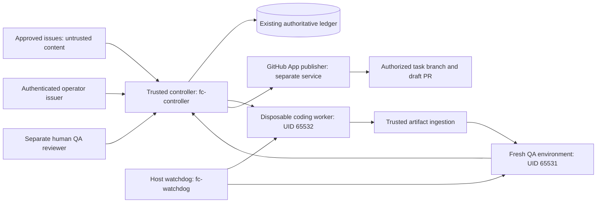

# Sprint 5.4 operator runbook

**Status: offline infrastructure package; live execution and live publication are
blocked in code.** No App installation, cloud deployment, model request, production
access, client/server modification or ledger reset is part of these commands.
This runbook fixes the architecture for a future canary; unresolved prerequisites
are explicit stop conditions, not operator choices to bypass.

## Architecture and identities



Use a dedicated Linux worker host with cgroup v2 and gVisor, outside production
networks. Keep the controller, ledger, authorization issuer, billing broker and
publisher on a separate trusted host. Use distinct OS/service identities and App
installations for reader and publisher. Coding UID 65532, QA UID 65531 and the
rehearsal controller UID 65530 are distinct **inside containers**; before live use,
attest host user-namespace mappings and separate hosts/daemons for coding and QA.
Numeric container UIDs alone are not separate host identities.

The launcher has authority over a dedicated Docker daemon and is trusted. Never
expose its socket to a worker, QA test, model tool or controller container. The
controller owns the ledger and publication orchestration; only the publisher
holds GitHub write credentials. Neither worker can approve itself or publish.

Ordinary Docker shares a host kernel and is **not a hardened VM boundary**. gVisor
adds a userspace kernel but retains host runtime, kernel, filesystem, denial of
service and side-channel risks. Before hostile live coding, use separate disposable
VMs (recommended) or a separately reviewed microVM runner with the same protocol,
no production routes and independently enforced egress denial. The shipped local
Docker rehearsal establishes functional isolation checks, not VM attestation.

## Local prerequisites and reproducible build

Use Linux x86_64, Python 3.12+, Git, GNU Make, Docker Engine with cgroup v2 and
`runsc` registered. Reserve at least 4 CPU, 8 GiB RAM and 10 GiB disposable disk
(use 30 GiB when the Docker storage driver is VFS);
only one task is active at a time. Image pulls need registry access during setup.
No external credentials are required. The Python images install no packages;
base layers are pinned by digest in `infra/images.lock.json`. The worker program
and standard-library dependencies are versioned here. Never substitute `latest`.

Install gVisor on the dedicated **local rehearsal host**, checking the exact hash
from `infra/runtime.lock.json` before executing the binary. CI demonstrates the
installation procedure. Docker restarts interrupt existing containers: use a
fresh host. Run `docker info` and verify cgroup v2 and the `runsc` runtime. The
pinned `runsc` version is `release-20260413.0`; security updates require a new
reviewed lock, probe results and image rebuild. No install occurs on production.

```sh
make lint test
make rehearsal
# Machine-readable evidence, after images have been built:
python3 src/infrastructure.py rehearse > /tmp/fc54-report.json
# Fast previous control-plane rehearsal (does not prove container isolation):
make rehearsal-local
```

`make rehearsal` builds separate controller/coding/QA image targets, then invokes
the trusted host harness. The controller image runs the existing synthetic ledger
rehearsal as a smoke test. The harness then verifies signed mock authorization,
reserves synthetic funds, exports an exact Git SHA, runs a fixed coding fixture in
a disposable container, destroys that container, ingests the allowlisted change,
and runs QA in a different image/UID with a fresh export. It records commit/tree
SHA, content digest, exit codes and output hashes, requires independent signed QA
review and signed publication approval, simulates one draft PR, reconciles mock
billing, preserves planning holds and retains the audit event history in its
report. The temporary rehearsal ledger is destroyed at exit; it never opens the
operational ledger. Synthetic keys are ephemeral test signing material, never real
API credentials. Actual ledger backup/retention procedures are below.

The rehearsal exercises invalid authorization, protected filesystem writes,
metadata/private/public egress attempts, missing billing, unreconciled candidate,
QA rejection, invalid publication, duplicate publication recovery, cancellation,
crashes and the persistent kill switch. Unit tests additionally cover process
subtree termination, deadlines, protected paths, policy mutations, stale SHAs,
replayed grants and crash/restart reservations.

## Sandbox policy and preflight

`specification()` constructs the complete launch. `validate_inspection()` verifies
Docker's effective config **after create, before start**, including immutable
image, entrypoint, command, role, UID, environment, mounts and resource limits.
The trusted QA runner disables process dumps before loading candidate files,
preventing same-UID test children from accessing its memory/evidence descriptors.
Unknown settings, inherited proxy credentials, host namespaces, volumes, devices,
privilege, extra caps or networking cause rejection. Worker requests are inert JSON,
never shell commands. There is no host workspace bind mount: `/workspace` is a
256 MiB tmpfs, `/tmp` is 64 MiB, root is read-only, memory+swap total is 2 GiB,
one CPU, 128 processes, 256 file descriptors and 8 MiB per file/output. No-new-
privileges and all capabilities dropped are mandatory. Networking is `none`,
including metadata, RFC1918 and model endpoints; no production DB is reachable.

The fixed negative probe runs under coding and QA identities and must pass before
the task. Inspect the report, not merely a successful build. Every execution has a
maximum 2,400-second supervisor deadline including startup; cancellation kills the
process group, forcibly removes the named container/cgroup and verifies absence.
Disposable tmpfs storage disappears with removal. A failed removal/inventory check
is an incident: retain holds, fence the task and stop dispatch.

For controller death, the dedicated host service template is
`infra/fc54-watchdog.service`. Install the reviewed checkout read-only at
`/opt/fort-custer-automation`, create `fc-watchdog` with access to the dedicated
daemon, then install/start this unit on the dedicated worker host. Its socket
access is equivalent to host authority; it must never handle untrusted code.
`host_watchdog.py` uses Docker's nonrenewable start time (creation time for
never-started orphans), removes labelled containers after 2,400 seconds and emits
structured failure/removal events. Test by killing a synthetic controller process
and confirming removal independently. It is not automatically installed here.

**Remaining deadline blocker:** watchdog polling/removal has latency and Docker
start can lag dispatch. Before live use a reviewed host cgroup deadline must be
registered at the ledger's original dispatch deadline, with an acknowledged
watchdog health check that blocks launch if absent. The shipped offline launcher
cannot attest host-service health after a host outage. Do not represent the local
process timeout as sufficient for this failure mode.

## Dedicated GitHub Apps: exact manual setup

Do not use a personal access token for live publication. Do not create/install
Apps through the agent. An authenticated repository owner performs these steps:

1. Open GitHub user/organization Settings → Developer settings → GitHub Apps →
   New GitHub App. Create **two** Apps named for Fort Custer reader and publisher.
   Use the organization's operator URL, disable webhooks (the controller polls),
   disable user OAuth authorization and account permissions, and select installation
   only on this account. Record client/App IDs and installation IDs in trusted
   configuration; these identifiers are not worker input.
2. Reader App repository permissions: **Metadata read** (implicit), **Contents
   read**, **Issues read**; everything else none. Install it with “Only select
   repositories” on `MZKZxyz/fort-custer-automation`, `MZKZxyz/fort-custer-client`
   and `MZKZxyz/fort-custer-server`. QA workers receive source exports, no token.
3. Publisher App: **Metadata read**, **Contents read/write**, **Pull requests
   read/write**; everything else none, especially Actions, Workflows,
   Administration, Environments and Deployments. Install only on the same three
   repositories; mint each token for a single explicitly approved repository.
   Do not give the reader this installation or share private keys.
4. The human owner creates each App private key in GitHub and stores it directly
   in a trusted secret manager/KMS-accessible broker store, outside images,
   repositories, issue bodies, logs and artifacts. Never paste or generate real
   keys here. Use separate key ACLs/service accounts. Audit access and rotate on
   compromise. HMAC approval keys are separate again, including a distinct QA
   reviewer key and subject allowlist.
5. Broker signs GitHub RS256 JWTs with `iss` equal to the configured App client ID,
   `iat=now-60`, `exp=now+540`, then posts to
   `POST /app/installations/{installation_id}/access_tokens`. Use the exact
   single-repository payload from `github_app_setup.token_request(role,repo)`.
   Cache only in broker memory, refresh before expiry and revoke after use using
   `DELETE /installation/token`. Installation tokens expire within one hour;
   JWT claims/token response validators are unit tested. `InstallationTokenBroker`
   remains code-blocked until the separately deployed signer/broker is reviewed.
   API responses may include implicit Metadata read; the validator accepts
   only that implicit read permission in addition to the requested permissions. Never loosen
   validation to accept unexpected write permissions or repository selection.
6. Only after signed, expiring, single-use operator publication approval and an
   independently accepted exact-SHA QA report may the publisher obtain a token.
   Use the existing durable outbox and `AppGitHub` transport. It creates an absent
   authorized `task/*` branch only, verifies reviewed remote head and all existing
   PR states, and opens a draft PR. Never retry an ambiguous create POST blindly.
   Source SHA, candidate SHA and reviewed report digest must all match. No direct
   `AppGitHub.push()` call is an operator authorization boundary.

GitHub App permission scopes do not limit writes to a branch. Before granting
publisher tokens, configure repository rulesets on all three repositories:

- Protect `main`: require PR review, required CI checks, no force pushes/deletions,
  no direct writes, and no bypass for either App. Enable enforcement for admins
  where supported. Do not put the publisher App on a main bypass list.
- Restrict creation/update to authorized `task/*` branches using the trusted
  publication broker's allowlist and rulesets where supported. Contents write is
  inherently broader than one branch; the broker is part of the trusted boundary.
- Disable automatic merging for the automation, require human review and never
  grant deployment permissions. Pin CI checks to exact candidate commits.
- Human owner verifies effective rules via repository Settings → Rules / Branches
  and records evidence; the connected App may lack Administration permission to
  inspect protections. Missing evidence is an activation blocker, not permission
  to proceed. Test unauthorized main writes using a dedicated test repository.

## Real server/client QA preparation

`ContainerQA` selects immutable controller-side policy for the repository. Issue
text cannot select argv. It binds source/candidate SHAs and the exported file hash;
`IndependentQA` separately records Git tree SHA, full diff, changed-file/protected
allowlists and every test result, then requires a separate authenticated reviewer.
Missing commands, dependency cache, MongoDB or browser binaries fail closed.

The shipped Python QA image proves the synthetic protocol only. Build a separate
reviewed Node QA image using `infra/Dockerfile.qa-node`; pin both bases, preload a
checksum-verified npm offline cache for the **exact reviewed package-lock.json**,
and checksum-verified local MongoDB 8.0.16 plus configured Playwright browsers.
`infra/qa-assets/README.md` specifies the staging layout. After asset staging, build with:

```sh
python3 src/infrastructure.py build-node-qa
docker image inspect fc54-qa-node:prepared --format '{{.Id}}'
```

Record that immutable ID and construct `ContainerQA(id, repository, synthetic=False)`
only from trusted controller policy; the live controller gate remains blocked.
No production credentials
or DB URLs, no runtime downloads, no install network. Cache building happens in a
separate disposable preparation environment with registry-only egress and no
publication keys; candidate code must not run there. Pin lock/source/image digests
in the operator evidence record. `npm ci --ignore-scripts --offline` runs inside QA;
review native bcrypt lifecycle/build requirements and preload approved build
artifacts if necessary. Missing native binaries must fail; never enable arbitrary
install scripts on the trusted controller.

Server policy: offline dependency installation, `node --test`, the offline analyzer
unit suite, deterministic analyzer smoke, and `node --check` for each JS file. Test
MongoDB is local and ephemeral, `MONGOMS_RUNTIME_DOWNLOAD=false`; use no production
DB. Client: offline dependency installation, nonwatch unit tests, production build,
and browser tests whenever `test:e2e` is configured (currently configured). Do not
silently skip browser checks because binaries are missing.

The real repositories' package scripts were read-only inspected during this
sprint. Their tests were not run or modified. The image/cache/MongoDB/browser asset
attestation and real-suite execution remain activation prerequisites. Current JSON
transport supports UTF-8 regular files up to 4 MiB and rejects symlinks, binary
files, `.env`, `.git`, generated dependencies and oversized artifacts. A broader
transport requires a reviewed, bounded protocol; do not silently omit files.

## Budget, monitoring and infrastructure cost

See [provider capability evidence and hard-ceiling blocker](BUDGET-EVIDENCE.md).
Keep $10/day, $3 reservation/task, concurrency one, 40 minutes, two retries and
no merge/deployment. The original advisory planner's concurrency setting is three;
Sprint 5.3 execution independently enforces one. Do not change the existing planner
or release holds to claim spending enforcement. No model credentials go into
workers. A credential-free bounded model/billing broker is still required.

Record image IDs, runtime hash, authorization nonce/subject, task/source/candidate
SHA, policy version, reservation, usage provenance, confirmed cost finality, QA
command exit codes and output hashes, separate QA reviewer and publication
outbox state. Do not persist raw worker output, tokens, JWTs, private keys or
unfiltered issue secrets in logs. Export ledger audit records and evidence digests
to access-controlled append-only storage. Alert immediately on watchdog failure,
container leftovers, stale leases, missing billing, invalid grants, QA mismatch,
duplicate drafts or any attempted live entrypoint. Keep unresolved funds reserved.

Capacity planning estimate only: a dedicated 4-vCPU/8-GiB runner might cost
$40–100/month and a small trusted controller $10–30/month; disposable VM isolation
and retained artifacts/backups add roughly $10–50/month depending on provider and
uptime. These are unquoted planning ranges, not measured costs or a provider
spending cap. Local rehearsal consumes host CPU/storage, no model credits. Obtain
an explicit hosting quote before provisioning; hosting costs are separate from
the model's $10 daily ceiling.

## Emergency stop, recovery and rollback

1. Authenticate to the independent operator issuer and consume a signed `kill`
   grant through the existing ledger API. A string username is insufficient.
   Pause the advisory scheduler and publisher service. Never erase the ledger.
2. Trusted host operator lists `docker ps -aq --filter label=fc.sprint=5.4`, then
   forcibly removes each identified container and checks the inventory is empty.
   If the daemon/watchdog is unavailable, isolate/shut down the dedicated worker
   host via its host operator. No production shutdown is part of this sprint.
3. Revoke publisher installation tokens and disable/revoke broker model authority
   if compromise is suspected. Preserve all unresolved budget holds and task leases.
4. Preserve the database, WAL/SHM and audit evidence before repair. Use SQLite's
   backup API under controller authority to create a consistent backup, encrypt
   and hash it, store off-host with access controls, and test restore regularly.
   Copying a running `.db` alone is insufficient. Never reset the planning ledger.
5. Restore to a fenced controller with scheduling disabled. Validate database
   integrity, append-only audit chain/record hashes against off-host evidence,
   task branch ownership and all external outcomes. Run existing `Ledger.recover()`;
   unknown usage/publication outcomes stay unresolved. Reconcile billing and
   remote PR state authoritatively; no automatic refund or retry of ambiguous POST.
6. Roll back application images/config to recorded immutable IDs while retaining
   the **current** ledger and persistent stop. This sprint adds no ledger schema
   migration. Do not restore an older ledger to roll back code. Rehearse recovery
   on a copy, then require a fresh authenticated activation review.

## First live canary: server #3 (preparation only)

Every unchecked prerequisite is a stop condition. Do not remove `require_live()`
in this sprint. The future activation change requires its own human review.

- [ ] Human confirms Sprint 5.3 and 5.4 reviewed/merged; preserves authoritative
  planning ledger and existing reservations with tested backup/restore.
- [ ] Run `make lint test rehearsal` on the intended disposable runner and retain
  report, immutable image IDs and runtime hash. Negative probes and all tests pass.
- [ ] Attest stronger VM isolation, separate coding/QA hosts or equivalent reviewed
  boundaries, mapped identities, no secret/controller mounts and denied egress.
- [ ] Deploy/verify independent watchdog with acknowledged **original dispatch**
  deadline and controller-death test. No worker heartbeat extends it.
- [ ] Complete authenticated operator issuer, distinct QA reviewer, trusted
  artifact ingestion and credential-free model transport deployments.
- [ ] Obtain hard $3 task / $10 daily provider limit or audited bounded-broker
  proof and authoritative complete billing reconciliation. Review all residual
  financial risks; soft budgets/telemetry cannot satisfy this item.
- [ ] Owner manually creates/installs the separate reader/publisher Apps and
  records effective repository rulesets and no-main-write evidence.
- [ ] Pin a fresh exact source SHA for `MZKZxyz/fort-custer-server#3`; human reviews
  issue and `config/canary-target.json`. Initial scope remains documentation-only:
  `docs/maze-generation-rejections.md`, `tools/maze-analyzer/README.md`.
  No generator, API, production DB or deployment changes are authorized.
- [ ] Prepare exact-lock server QA image and local test MongoDB, run all server
  checks against that SHA in the independent environment and retain signed evidence.
- [ ] Review a separate activation PR implementing remaining attested interfaces;
  no config/env override may bypass the current unconditional gate.
- [ ] Operator issues a fresh single-use dispatch capability binding repository,
  task branch, source SHA, allowed files, budget and deadline. Reserve $3, one task.
- [ ] After worker termination and authoritative billing, ingest exact candidate,
  verify full diff/file allowlist, run fresh exact-SHA QA and obtain separate risk
  review. Any missing evidence stops publication and preserves unresolved holds.
- [ ] Obtain a distinct authenticated publication grant binding candidate/report;
  broker creates the authorized task branch and **draft** PR once. Human reviews.
- [ ] Verify audit/reconciliation, destroy task data and leave concurrency one.
  Automatic merge and production deployment remain disabled. No merge is authorized.
