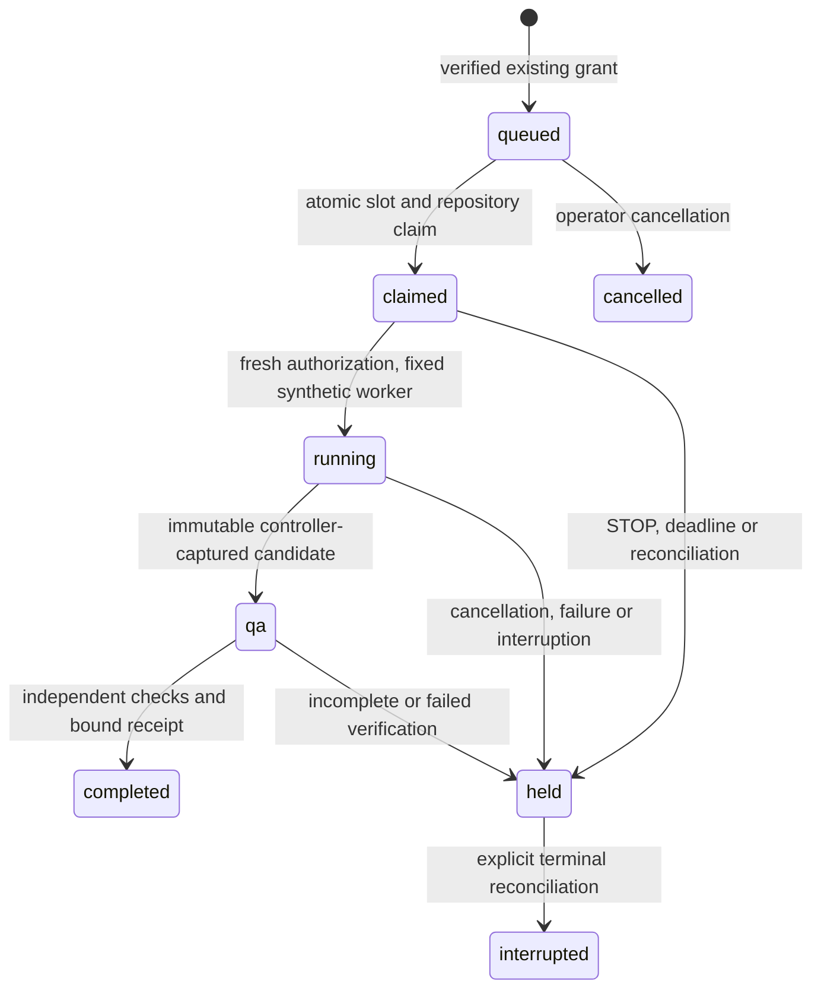

# Sprint 6.7 — concurrency readiness

`src.concurrency_coordinator` implements `concurrency-coordinator-v1` in a new,
private SQLite ledger. Configured capacity is 1–3; live capacity remains exactly
one. This implementation has **no live dispatch method**. Its only worker is the
exact `SyntheticWorker` class, an inert in-process fixture edit. The example is
disabled. No scheduler, unattended dispatcher, approval or publisher is added.
Existing controller approval and publication CLIs remain the authority.

## Protocol and operator workflow

Use Python 3.11+ and protected local Unix storage. Copy
`config/concurrency.example.json` into an operator-owned 0600 file in a protected
0700 directory. Replace paths and include every relevant controller `state/STOP`.
Scratch must be private and separate from controller, policy, ledger, source and
operator credential home. Provision the ledger parent yourself. Configuration is
bound into ledger metadata: changes fail closed, including changes to capacity.
Never initialize a replacement ledger to evade a claim or historical identity.

```sh
umask 077
python3 -m src.concurrency_coordinator init --config /operator/concurrency/config.json
python3 -m src.concurrency_coordinator slots --config /operator/concurrency/config.json
python3 -m src.concurrency_coordinator inspect --config /operator/concurrency/config.json
python3 -m src.concurrency_coordinator active --config /operator/concurrency/config.json
python3 -m src.concurrency_coordinator queued --config /operator/concurrency/config.json
python3 -m src.concurrency_coordinator completed --config /operator/concurrency/config.json
python3 -m src.concurrency_coordinator failed --config /operator/concurrency/config.json
python3 -m src.concurrency_coordinator resources --config /operator/concurrency/config.json
```

Initialization exclusively creates the new coordinator store. Other commands
above are read-only; initialization does not enable anything. There is deliberately
no CLI for enqueue, approval or launch. The Python readiness API is exercised only
with temporary offline fixtures. Do not connect this synthetic API to operational
coding grants or a daily scheduler. Never run an old live runner alongside a
synthetic experiment against operational state: this separate ledger does not
atomically consume grants in the old controller. Future live integration must
consume the authoritative controller grant and coordinate every dispatch path in
one transaction/broker before startup. No live exclusivity across separate legacy
controller stores is claimed by this readiness module.

`enqueue(policy_path, execution_id, task_id)` independently reads the current
protected catalog and controller ledger. It checks the exact spec, approval audit
history/binding, expiration, enabled policy, source manifest and SHA, repository
origin/identity, fixed QA grammar, STOP and existing running controller holds.
It neither prepares nor approves a task. Advisory planning is never accepted.
Queue records freeze policy/catalog digests, task, execution, source, allowlist,
QA and authorization digest. A changed policy, grant or source blocks claiming
and startup. Source HEAD must still equal the approved SHA; nothing rebases.

`claim(task, slot, worker)` takes `BEGIN IMMEDIATE`, checks current authorization
again, and atomically appends ownership before startup. Unique task/execution
records and replayed active slot/repository ownership serialize independent
coordinator processes sharing this ledger. SQLite FULL synchronous commits retain
claims after crashes. Use a single protected local ledger, not copies, network
filesystems or independently initialized stores. Slot identity, worker identity,
unique fencing token, monotonic event generation, start/deadline, cancellation and
STOP fields bind the claim to its immutable authorization record.

## State machine and failure recovery



A held claim continues occupying its slot and canonical repository. Elapsed time,
worker status, process exit, controller restart or missing output never prove it
safe to reassign. There is no automatic retry/requeue, heartbeat lease stealing,
side-effect replay or reuse of an execution/task identity. Repository collision
leaves distinct tasks queued. No same-repository exception is configurable.

`guard` checks ownership/fencing, STOP (including broken symlinks) and deadline.
`sweep` records STOP/deadline cancellation intent and an unconfirmed termination
hold; it does not pretend to kill or confirm an external worker. `cancel` is sticky
in ledger history. In-progress QA uses the existing process-group supervisor and
its controller-death guardian. Cancellation is polled by that supervisor. Failure
to verify termination, incomplete QA, partial writes or abrupt death remain held.
A crashed claim before startup remains claimed until explicit sweep/hold/recovery;
inspection displays the required recovery action. Nothing restarts on import.

After an interruption, stop dispatch, activate the existing controller STOP,
inspect the exact slot/token and all process descendants, preserve the database,
source and candidate evidence, and independently verify termination. Use the
existing controller's recovery rules for its own ledger; never edit its history.
Record a specific reason and reconcile this claim in a controlling terminal:

```sh
python3 -m src.concurrency_coordinator recover --config /operator/concurrency/config.json \
  --task TASK_ID --reason 'Verified no surviving processes; preserved partial evidence'
```

The CLI requires typing `RECONCILE <digest-of-exact-claim>` through `/dev/tty`.
This consumes the coordinator identity permanently as interrupted. The operator's
termination assertion is trusted, not an externally measured attestation. An old
token cannot start or finalize anything after recovery. Missing, contradictory or
unknown protocol/configuration state fails closed. Never clear STOP as a side
effect of recovery. Rollback means stop using this module, retain its ledger and
artifacts, and restore the previous source version after reconciling every active
claim; deleting a ledger is not rollback.

## Isolation contract and independent QA

Each synthetic attempt gets a random token-bound private scratch directory and
materialized checkout without `.git`; there are no shared writable worktrees or
application state. Controller source Git objects are read-only inputs. Controller
captures source and result manifests and allowlisted changed bytes into immutable
SQLite events. The fixed synthetic adapter has no executable arguments, subprocess,
network, environment lookup, approval-store lookup or credential operations.
Synthetic workers are ordinary trusted Python functions in the controller process:
they do not have an independently restricted OS environment or security boundary.
Mocking that function in tests is test instrumentation, not a supported worker API.

QA independently reconstructs the exact source plus captured delta in a fresh
checkout. It validates manifests, paths, modes, complete file set and allowlist,
and uses the existing controller QA implementation: pinned Node hash, fixed
`node --check FILE` / `node --test FILE` grammar, exact approved timeouts, diff
check, candidate tree/revision/patch and post-QA mutation rejection. QA subprocesses
use the existing minimal environment allowlist, bounded log supervisor and process
guardian. No worker-selected checks or worker test reports confer trust. Final
receipts bind task, execution, authorization, claim token, source, candidate and
artifact digest. Read-only observations recheck receipts, current reviewed policy,
command identity and candidate reconstruction; changed evidence blocks observation.

**Before any future live concurrent execution**, provide an independently reviewed
external sandbox per worker (separate host/VM or hardened container identity with
mount/namespace controls), no publisher/model-management credentials, no privileged
policy/approval store mounts, restricted explicit environment, fixed executable and
argument allowlists, source read-only ingress and controller-owned output ingestion,
network denial matching the worker model, enforced process-tree termination, and
hard storage/log/CPU/memory limits outside worker control. QA needs its own sandbox
because approved test files still execute code. A single macOS UID, separate cwd,
process group, Python class check or environment dictionary is **not** a sufficient
security boundary. This sprint does not provision those external controls.

## Accounting and enforcement limits

Per-task receipts record input/cached/output tokens, synthetic exit status,
execution/QA wall duration and candidate bytes. Failed attempts retain available
metrics; fields without observations remain null and are listed explicitly.
Aggregates sum available samples only; they are not complete usage totals when
some tasks have unavailable samples. The fixed synthetic values measure fixture
accounting, not subscription inference. CPU time and peak memory are unavailable.
No subscription monetary cap is claimed or invented.

Configured ceilings bound slot count, task count, controller evidence payloads,
SQLite page count and candidate ingestion. SQLite exhaustion rolls back the final
transaction and retains the prior ownership state. These do not impose a hard
aggregate scratch disk, temporary-file, CPU, memory or network quota. Existing
per-file and log checks are software guards and can overshoot between checks.
Hard host resource/network enforcement is explicitly unsupported until external
infrastructure exists. Configuration cannot enable live execution or increase its
limit. Capacity changes require separate operator-reviewed configuration/storage
provisioning and code review for any live path; never clone active ledgers.

`src.task_orchestration.coordinator_observations(config)` is the optional versioned,
read-only `concurrency-observations-v1` adapter. Its output explicitly has no approval
authority. Existing orchestration configuration/snapshots and daily planning remain
unchanged; there is no new unattended path. Historical ledgers and Issue #3 evidence
are untouched. Human coding, catalog promotion and separate publication approval
boundaries remain intact.

## Offline demonstration

```sh
python3 examples/three_worker_coordination.py
python3 -m unittest discover -s tests -p test_concurrency_coordinator.py -q
make test
make lint
```

The demo creates three temporary independent controller fixtures, calls the existing
prepare/approve implementation for each, then uses a barrier to prove three
simultaneously owned independent workspaces. Synthetic approvals are test setup,
not user/operator approvals and never touch operational records. Production allows
only the server/client repository identities; the fixture temporarily extends the
allowlist with three fake `offline/repository-N` identities in that process only.
No runtime allowlist change or same-repository exception is shipped. Separate tests
prove two tasks with the same repository stay queued until the first completes.
Demo directories are deleted on completion; durable copies of the printed example
are supplied in the evidence document. No real Codex worker is launched.
